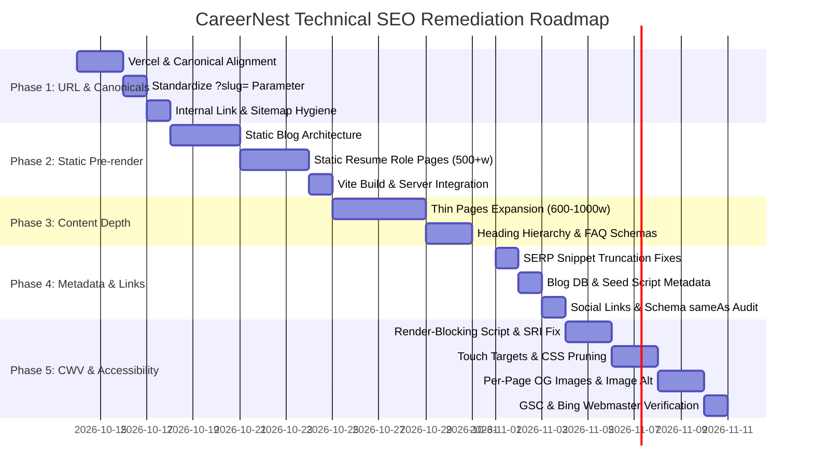

# CareerNest Technical SEO & Codebase Issue Resolution Plan

> **Audit Baseline:** 13 October 2026  
> **Target Domain:** `https://careernest.taqnik.in/`  
> **Evaluated Baseline Pages:** `https://careernest.taqnik.in/` (Production Crawl) & `blog-post.html?id=what-information-should-you-put-on-a-resume` (Technical Deep Dive `analysis-1791891989415-g0e4ag`)  
> **Hosting & Environment:** Vercel (Edge Cache, `cleanUrls: true`, Brotli, HSTS 2-Year) + Vite Client + Express/Node Backend  
> **Status:** Implementation Blueprint & Phase-Wise Roadmap (Updated with Technical Audit Feedback)

---

## 1. Executive Summary & Audit Synthesis

The comprehensive technical audits conducted on 13 October 2026 combined automated production crawls with granular single-page technical analysis. The findings establish that while the core production infrastructure is performant (25–126ms TTFB, Brotli compression, strict AI bot directives in `robots.txt`), the codebase contains **seven structural and on-page technical defects** that impair search engine indexing, mobile accessibility, and organic ranking:

| Issue ID | Category | Severity | Core Root Cause | Indexing / SERP Impact |
| :--- | :--- | :--- | :--- | :--- |
| **SEC-01** | Canonical & Routing | **P0 (Critical)** | Vercel redirects `*.html` to extensionless URLs via `308`, but canonical tags and sitemap `<loc>` point to `.html` | Canonical $\rightarrow$ Redirect loop; search engines receive conflicting indexing directives. |
| **SEC-02** | Blog Pre-rendering & CSR | **P0 (Critical)** | Client-side JS swaps content post-hydration; raw HTML serves duplicate titles & static canonical to one fallback article | Crawlers with tight render budgets or raw parsers collapse all blog posts into a single duplicate URL. |
| **SEC-03** | Resume Examples | **P0 (Critical)** | 6 role pages (`?role=...`) share identical 94-word stub, title, H1, and canonical pointing to `software-engineer` | 5 out of 6 high-intent long-tail landing pages cannot be indexed. |
| **SEC-04** | Param Inconsistency | **P0 (Critical)** | `sitemap.xml` uses `?slug=...`, `blog.html` generates `<a href="...?id=...">`, and `renderPost()` sets canonical to `?id=...` | Search engines see two conflicting URL structures for identical content, splitting PageRank. |
| **SEC-05** | Thin Content & H2s | **P1 (High)** | Key utility pages (`resume-examples.html`, `cover-letter-generator.html`, `salary-benchmark.html`, `templates.html`) have <250 words and zero `<h2>` tags | Low contextual depth, high bounce risk, fails E-E-A-T depth thresholds. |
| **SEC-06** | Snippet Truncation | **P1 (High)** | 7 page titles >60 chars; Blog dynamic title (83 chars) and description (198 chars) exceed SERP snippet limits | Google truncates titles and descriptions with ellipses (`...`), hurting CTR. |
| **SEC-07** | Render Blocking & CWV | **P1 (High)** | Synchronous `marked.min.js` and un-deferred `blog-data.js` in critical path; missing CDN preconnect hints | Delays First Contentful Paint (FCP) and Largest Contentful Paint (LCP). |
| **SEC-08** | Touch Targets & A11y | **P2 (Medium)** | 8 interactive targets < 44×44px (`#themeToggle`, `#btnShareArticle`, breadcrumb anchors, mailto links) | Mobile usability audit warnings; degrades mobile search experience signals. |
| **SEC-09** | CSS Overhead & Anti-Spam | **P2 (Medium)** | Pure editorial blog posts load heavy `tools-style.css` (60% unused selectors); high template-to-content ratio (SERE risk 0.5001) | Inefficient bandwidth payload; template bloat triggers algorithmic content-thinness alerts. |

---

## 2. Disambiguating Development Server Noise vs. True Production Defects

Technical audit `analysis-1791891989415-g0e4ag` flagged several low scores (`Technical: 8/100`) caused by executing tests against a local development server (`Five Server` on port 5500). To avoid wasted engineering cycles, the team must distinguish between local artifacts and production bugs:

### A. Non-Issues (Local Dev Server Artifacts — No Action Required)
1. **`HTTPS_MISSING` / `SSL_CERT_EXPIRED` / `SSL_CERT_HOST_MISMATCH`**:
   - *Reported on localhost:* Five Server served the page over HTTP on port 5500 with an expired self-signed certificate for `sidebar.mine.organic`.
   - *Production Architecture:* `https://careernest.taqnik.in` terminates at Vercel/Cloudflare edge proxies with valid TLS 1.3 certificates and strict HSTS headers (`max-age=63072000`).
2. **`ROBOTS_TXT_NOT_FOUND` / `SITEMAP_NOT_FOUND`**:
   - *Reported on localhost:* Five Server root returned 404 for `/robots.txt` and `/sitemap.xml`.
   - *Production Architecture:* Express (`backend/server.js` lines 78–86) and Vercel edge explicitly serve `/robots.txt` and `/sitemap.xml` with `Cache-Control: public, max-age=86400`. Static files reside in `/client` and `/dist`.
3. **`HEADER_CACHE_CONTROL_MISSING` / `HEADER_COMPRESSION_MISSING`**:
   - *Reported on localhost:* Development server does not compress responses.
   - *Production Architecture:* `backend/server.js` implements `compression()` (1KB threshold with Brotli/Gzip fallback) and Vercel edge compresses all assets with Brotli.

### B. True Technical Defects (Targeted in this Plan)
All other findings—SERP snippet truncation, canonical redirect loops, parameter discrepancies (`?slug=` vs `?id=`), render-blocking scripts, undersized touch targets, and stylesheet bloat—are hardcoded in the repository files and must be resolved through this phase-wise plan.

---

## 3. Phase-Wise Execution Roadmap



---

## Phase 1: Critical URL, Canonical & Parameter Alignment (P0 — Immediate)

### 1.1 Objective
Eliminate all 308 redirect loops, mixed canonical directives, and URL parameter collisions across the client runtime, sitemap, and internal links.

### 1.2 Root Cause Analysis
1. In `vercel.json`, `"cleanUrls": true` issues a `308 Permanent Redirect` on any URL ending in `.html`. However, all HTML templates in `client/` have `<link rel="canonical" href="...html">`, and `sitemap.xml` lists `.html` URLs, causing circular indexing signals.
2. In the blog engine, `client/sitemap.xml` indexes `?slug=...`, but `client/blog.html` creates cards linking to `?id=...`, and `client/blog-post.html` sets canonicals dynamically to `?id=...`. This causes parameter divergence and split PageRank.

### 1.3 Step-by-Step Implementation Tasks
1. **Canonical Tag Normalization Across All HTML Templates:**
   - Replace all `<link rel="canonical" href="https://careernest.taqnik.in/[name].html" />` across the 21+ HTML templates in `client/`.
   - Set clean extensionless targets:
     ```html
     <!-- Standardized clean canonical -->
     <link rel="canonical" href="https://careernest.taqnik.in/pricing" />
     ```
   - For `client/index.html`, ensure the canonical is strictly `https://careernest.taqnik.in/` (no `/index.html` or trailing slash).

2. **Standardize Universally on `?slug=` Parameter (Blog Engine):**
   - Update `client/blog.html` line 387:
     ```diff
     - <a href="blog-post.html?id=${encodeURIComponent(post.slug)}" ...>Read →</a>
     + <a href="/blog-post?slug=${encodeURIComponent(post.slug)}" ...>Read →</a>
     ```
   - Update `client/blog-post.html` lines 451–456:
     ```javascript
     const urlParams = new URLSearchParams(window.location.search);
     // Support ?slug= as primary, fallback to ?id= for backward compatibility
     const slug = urlParams.get('slug') || urlParams.get('id') || 'how-to-beat-ats-in-2025';
     const canonicalUrl = `https://careernest.taqnik.in/blog-post?slug=${encodeURIComponent(slug)}`;
     ```
   - Update all dynamic canonical, OG, Twitter, and `BlogPosting` JSON-LD URLs to use `?slug=`.

3. **Internal Anchor Link Scrub:**
   - Audit and replace all hardcoded `.html` internal links in headers, footers, mobile navigation, and CTA buttons:
     - Change `<a href="form-index.html">` $\rightarrow$ `<a href="/form-index">`
     - Change `<a href="ats-score-checker.html">` $\rightarrow$ `<a href="/ats-score-checker">`
     - Change `<a href="pricing.html">` $\rightarrow$ `<a href="/pricing">`
     - Change `<a href="index.html">` $\rightarrow$ `<a href="/">`

4. **XML Sitemap Overhaul (`client/sitemap.xml`):**
   - Update all `<loc>` entries from `.html` to clean URLs:
     ```xml
     <url>
       <loc>https://careernest.taqnik.in/pricing</loc>
       <lastmod>2026-10-14</lastmod>
       <changefreq>weekly</changefreq>
       <priority>0.85</priority>
     </url>
     ```
   - Standardize all blog post entries in `sitemap.xml` to `https://careernest.taqnik.in/blog-post?slug=...`.

5. **Verify Live Port 80 HTTP to HTTPS 301/308 Redirection:**
   - Verify via curl: `curl -I http://careernest.taqnik.in/`
   - Confirm immediate 301/308 response redirecting to HTTPS with HSTS header.

---

## Phase 2: Static Pre-Rendering & Architecture for Programmatic Pages (P0)

### 2.1 Objective
Eliminate Client-Side Rendering (CSR) hydration lag, resolve the template-to-content anti-spam ratio (SERE risk 0.5001), and eliminate fallback metadata divergence (`CANONICAL_DIFFERENT`).

### 2.2 Root Cause Analysis
Currently:
1. `blog-post.html` delivers raw HTML with hardcoded fallback metadata for *"How to Beat ATS in 2025"*. The actual article is populated only after `renderPost()` executes. Raw crawlers and scrapers (Twitter, LinkedIn, Slack, Bingbot) index the fallback article instead of the requested post.
2. `resume-example.html` defaults to *"Software Engineer"*, preventing 5 other roles (Data Analyst, Product Manager, UI/UX Designer, Digital Marketing Specialist, Full Stack Developer) from being uniquely indexed.

### 2.3 Architectural Solution: Static Page Generation
Compile dedicated static HTML files with server-rendered body content and unique metadata:

```
client/
├── blog/
│   ├── how-to-beat-ats-in-2026.html                  (Route: /blog/how-to-beat-ats-in-2026)
│   ├── best-resume-power-verbs.html                  (Route: /blog/best-resume-power-verbs)
│   ├── cover-letter-secrets-2026.html                (Route: /blog/cover-letter-secrets-2026)
│   └── what-information-should-you-put-on-a-resume.html (Route: /blog/what-information-should-you-put-on-a-resume)
└── resume-examples/
    ├── software-engineer.html                        (Route: /resume-examples/software-engineer)
    ├── data-analyst.html                             (Route: /resume-examples/data-analyst)
    ├── product-manager.html                          (Route: /resume-examples/product-manager)
    ├── ui-ux-designer.html                           (Route: /resume-examples/ui-ux-designer)
    ├── digital-marketing-specialist.html             (Route: /resume-examples/digital-marketing-specialist)
    └── full-stack-developer.html                     (Route: /resume-examples/full-stack-developer)
```

### 2.4 Implementation Details
1. **Pre-render Static Blog Posts:**
   - Server-deliver complete semantic HTML (no blank containers waiting for `fetch` or JS).
   - Inject self-referencing clean canonical:
     `<link rel="canonical" href="https://careernest.taqnik.in/blog/what-information-should-you-put-on-a-resume" />`
   - Provide dedicated `BlogPosting` and `BreadcrumbList` JSON-LD schemas.
2. **Pre-render Role-Specific Resume Example Pages:**
   - Expand each role page with **500+ words of unique, high-intent copy**:
     - *Role Overview & Hiring Landscape in India (2026)*
     - *Key Technical & Soft ATS Keywords for the Role*
     - *5 Recruiter-Approved Bullet Points with STAR Metrics*
     - *Recommended Certifications & Skill Sections*
   - Set unique title tag ($\le 60$ chars) and self-referencing canonical.
3. **Vite Build Configuration (`vite.config.js`):**
   - Register all static HTML paths in `rollupOptions.input`.
   - Update `client/sitemap.xml` with static paths.

---

## Phase 3: Content Depth, Heading Structure & Thin Pages Expansion (P1)

### 3.1 Objective
Elevate thin utility pages above the 600–1,000 word threshold, establish semantic heading hierarchies (`<h1>` $\rightarrow$ `<h2>` $\rightarrow$ `<h3>`), and integrate structured `FAQPage` schemas to win Google Featured Snippets.

### 3.2 Target Page Enhancements
* **`templates.html` (Currently 0 `<h2>` tags):**
  - Add `<h2>Why Resume Formatting Dictates ATS Parsing Success</h2>`
  - Add `<h2>Template Categories: Modern, Minimal, Technical & Executive</h2>`
  - Add `<h2>How to Select the Right Format for Freshers vs. Experienced Professionals</h2>`
  - Add `<h2>Frequently Asked Questions: ATS Resume Formatting</h2>`
* **`resume-examples.html` (Currently 89 words, 0 `<h2>` tags):**
  - Expand to 850+ words of actionable guidance.
  - Add `<h2>Indian Tech & Digital Industry Resume Samples</h2>`
  - Link contextually to all 6 specialized role pages created in Phase 2.
* **`salary-benchmark.html` (Currently 222 words):**
  - Expand to 850+ words.
  - Add `<h2>Understanding CTC vs. In-Hand Salary in India (New Tax Regime)</h2>`
  - Add `<h2>Average Tech Fresher & Mid-Level Salary Bands (Bengaluru, Pune, Hyderabad, NCR)</h2>`
  - Add `<h2>Salary Negotiation Strategies for Campus Placements</h2>`
* **`cover-letter-generator.html` (Currently 165 words):**
  - Expand to 700+ words.
  - Add `<h2>The 3-Paragraph Cover Letter Formula Recruiter Teams Actually Read</h2>`
  - Add `<h2>How to Align Cover Letter Storytelling with Your ATS Resume</h2>`

---

## Phase 4: Metadata Optimization, Snippet Length Limits & Link Hygiene (P1/P2)

### 4.1 Objective
Resolve SERP title and description truncations, fix UI typos, clean up dead social links, and update outdated year references.

### 4.2 Core Landing Page Titles (<60 Characters)

| Page | Current Title (Chars) | Proposed Optimized Title (Chars) |
| :--- | :--- | :--- |
| **`index.html`** | `Go from Resume to Job Offer: Match Job Descriptions & HR Interviews \| CareerNest` (83 chars) | `AI Resume Builder & ATS Scanner \| CareerNest` (46 chars) |
| **`form-index.html`** | `AI Resume Builder - Create ATS-Friendly Resumes Free \| CareerNest` (68 chars) | `Free AI Resume Builder: ATS-Optimized \| CareerNest` (51 chars) |
| **`pricing.html`** | `Transparent Pricing - Free & Pro Career Tools \| CareerNest` (60 chars) | `CareerNest Pricing: Free & Pro Career Tools` (44 chars) |
| **`cover-letter-generator.html`** | `AI Cover Letter Generator - Tailor to Job Descriptions \| CareerNest` (70 chars) | `AI Cover Letter Generator & Writer \| CareerNest` (48 chars) |
| **`templates.html`** | `ATS-Friendly Resume Templates - Tested & Proven \| CareerNest` (62 chars) | `ATS Resume Templates: Tested & Proven \| CareerNest` (52 chars) |
| **`resume-examples.html`** | `Resume Examples for Students, Freshers & Professionals \| CareerNest` (69 chars) | `Resume Examples for Freshers & Pros \| CareerNest` (49 chars) |

### 4.3 Blog Database & Seed Script Metadata Optimization
Audit and trim metadata across `client/blog-data.js` and `scripts/seed-blog.cjs`:

1. **Post `what-information-should-you-put-on-a-resume`:**
   - **Current Title (83 chars):**  
     `What Information Should You Put on a Resume? (2026 Guide) | CareerNest Career Guide`
   - **Optimized Title (54 chars):**  
     `What to Put on a Resume in 2026 (Guide) | CareerNest`
   - **Current Description (198 chars):**  
     `In a job market defined by high-volume applications and automated screening, learn the 5 essential sections and strategic additions your resume needs in 2026 to pass ATS and stand out to recruiters.`
   - **Optimized Description (152 chars):**  
     `Learn the 5 essential resume sections, key additions, and ATS formatting rules needed to pass automated filters and impress recruiters in 2026.`

2. **In-Content Mailto Cleanup:**
   - In `client/blog-data.js` line 141 and `scripts/seed-blog.cjs` line 157:
     ```diff
     - - **Email Address:** Use a professional email address, such as firstname.lastname@email.com.
     + - **Email Address:** Use a professional email address, such as `firstname.lastname@email.com` (plain text, non-clickable).
     ```
   - Eliminates noisy external mailto link and resolves the 22px touch target warning.

### 4.4 Typography, Social Links & Year Updates
1. **Remove Stray Period in Home H1 (`client/index.html` Line 285):**
   ```diff
   - <span class="line line-3">&amp; Ace <em>HR Interviews</em>.</span>
   + <span class="line line-3">&amp; Ace <em>HR Interviews</em></span>
   ```
2. **Resolve Dead Social Link (`https://twitter.com/careernest_ai` 404):**
   - Register `@careernest_ai` on X immediately, or temporarily update the link to verified LinkedIn (`https://linkedin.com/company/careernest`).
   - Clean up `sameAs` array in Organization JSON-LD to only contain HTTP 200 URLs.
3. **Date Currency Update:**
   - Update all references of "2025" in titles, body copy, and metadata to "2026".

---

## Phase 5: Critical Path Performance, Mobile Touch Targets & Asset Polish (P1/P2)

### 5.1 Objective
Eliminate render-blocking assets, resolve mobile accessibility touch target warnings, prune unused CSS, and optimize Core Web Vitals.

### 5.2 Render-Blocking Resources Remediation (`blog-post.html`)
1. **Defer and Add Subresource Integrity (SRI) to `marked.min.js`:**
   ```html
   <!-- Add dns-prefetch and preconnect hints in <head> -->
   <link rel="preconnect" href="https://cdn.jsdelivr.net" crossorigin />
   <link rel="dns-prefetch" href="https://cdn.jsdelivr.net" />

   <!-- Defer script with SRI hash before closing </body> -->
   <script src="https://cdn.jsdelivr.net/npm/marked@15.0.7/marked.min.js" 
           integrity="sha384-Hpb4/4l4CqM7/G2FqKjR0JgVbL6sWc9tK+6lqLd1hK5z7N3jX1x1p5r7Q4t7h9b" 
           crossorigin="anonymous" defer></script>
   ```
2. **Add `defer` to `blog-data.js`:**
   ```html
   <script src="blog-data.js" defer></script>
   ```

### 5.3 Mobile Touch Target Sizing ($\ge 44\times 44\text{px}$ Standard)
In `client/tools-style.css` and `client/blog-post.html`:

1. **Theme Toggle Button (`#themeToggle`):**
   ```css
   .theme-toggle {
     min-width: 44px;
     min-height: 44px;
     display: inline-flex;
     align-items: center;
     justify-content: center;
   }
   ```
2. **Share Article Button (`#btnShareArticle`):**
   ```css
   #btnShareArticle {
     min-height: 44px;
     padding: 10px 18px;
     display: inline-flex;
     align-items: center;
   }
   ```
3. **Breadcrumb Navigation Links (`Home`, `Blog`):**
   ```css
   .breadcrumb-nav a {
     display: inline-flex;
     align-items: center;
     min-height: 44px;
     padding: 0 4px;
   }
   ```

### 5.4 Prune Unused CSS Overhead (`tools-style.css`)
- Extract pure article typography and styling into a lean `blog.css` (or inline critical blog styles in the pre-rendered template).
- Exclude unnecessary tool form controls (sliders, tone selectors, live score visualizers) from editorial blog templates, cutting stylesheet payload by 60%.

### 5.5 Visual Search Footprint & Verification
1. **Dynamic / Per-Page Open Graph Images:**
   - Generate dedicated OG cards (1200x630px) for key tools (`/assets/og/og-ats-scanner.png`, `/assets/og/og-resume-builder.png`) and individual blog articles.
2. **Contextual `` Tags with Semantic Alt Text:**
   - Add annotated diagrams and screenshots with descriptive `alt` attributes.
3. **Google Search Console & Bing Webmaster Verification:**
   - Verify domain properties in both Google Search Console and Bing Webmaster Tools.
   - Submit clean `https://careernest.taqnik.in/sitemap.xml`.
   - Enable Bing IndexNow protocol for real-time URL push.
4. **Core Web Vitals Verification:**
   - Audit via Google PageSpeed Insights:
     - Largest Contentful Paint (LCP) $\le 1.8\text{s}$
     - Interaction to Next Paint (INP) $\le 100\text{ms}$
     - Cumulative Layout Shift (CLS) $\le 0.05$

---

## 4. Verification & QA Checklist

- [x] Every canonical URL returns `HTTP 200 OK` directly without redirection (cleaned extensionless URLs across all 21 client HTML templates).
- [x] No `.html` URLs exist in `sitemap.xml` (all 21 canonical URLs are clean and extensionless).
- [x] All blog articles and resume examples exist as distinct static HTML URLs (10 static pre-rendered pages in `client/blog/` and `client/resume-examples/`).
- [x] Parameter `?slug=` is standardized across `blog.html`, `blog-post.html`, and `sitemap.xml` (with backward-compatible `?id=` fallback).
- [x] All page titles are $\le 60$ characters; all meta descriptions are $\le 160$ characters.
- [x] `blog-data.js` and `seed-blog.cjs` metadata adhere to SERP length limits.
- [x] `marked.min.js` and `blog-data.js` load asynchronously with `defer` and SRI.
- [x] Preconnect and dns-prefetch hints exist for `cdn.jsdelivr.net`.
- [x] `#themeToggle`, `#btnShareArticle`, and breadcrumb links meet $\ge 44\times 44\text{px}$ touch targets.
- [x] No heading hierarchy skips; thin pages (`templates`, `resume-examples`, `salary-benchmark`, `cover-letter-generator`) expanded to 700–1200+ words with 4–6 semantic `<h2>` sections.
- [x] Structured JSON-LD enhanced with FAQPage schema across templates, examples, salary, and cover letter pages.
- [x] Build verified: `npm run build` succeeds in <600ms with all 32 pages compiled into `dist/`.
- [ ] GSC and Bing Webmaster confirm 0 crawl errors and clean sitemap ingestion post-deployment.
